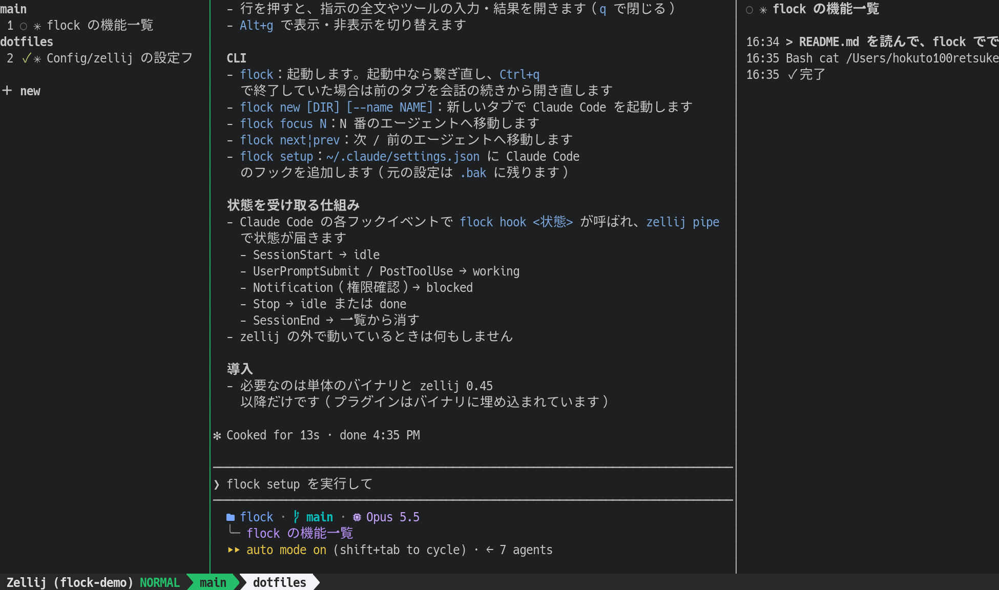

# flock

A zellij sidebar that shows the state of the coding agents running in each pane.



- Rows are ordered by tab position, then by pane creation order. They don't move when a state changes.
- States: `⠋` working / `●` blocked / `✓` done (finished while you weren't looking) / `○` idle
- States come from Claude Code hooks through `zellij pipe`. Only panes that have reported a state are listed.
- Click a row to jump to that pane. Click a tab name to rename it. `＋ new` opens a new tab in the current pane's folder and starts Claude Code there.
- `Alt+j` / `Alt+k` move to the next / previous agent (only inside a flock session; use `Alt+↓` / `Alt+↑` to move between panes vertically).
- The right side shows the focused agent's prompts and actions (tools and the files or commands they touched) with timestamps. Click a row to open the full prompt or the tool's input and output (`q` to close). `Alt+g` toggles it.

## Install

Download the binary for your platform from [Releases](https://github.com/hokuto100retsuken/flock/releases) and put it on your PATH. The sidebar plugin is embedded in the binary, so the only other requirement is [zellij](https://zellij.dev/) 0.45 or later.

```sh
# macOS (Apple Silicon)
curl -L https://github.com/hokuto100retsuken/flock/releases/latest/download/flock-aarch64-apple-darwin.tar.gz | tar xz -C ~/.local/bin
flock setup        # add the hooks to your Claude Code settings
```

To build from source: `cargo install --git https://github.com/hokuto100retsuken/flock flock`. The Rust version and the WASM target are pinned in `rust-toolchain.toml` (rustup installs them automatically).

## Usage

```sh
flock              # start; reattach if running, or reopen the previous tabs with their conversations if it was quit with Ctrl+q
flock new [DIR] [--name NAME]  # start Claude Code in a new tab (DIR defaults to the current folder, NAME to the folder name)
flock focus N      # move to agent N in the sidebar
flock next|prev    # move to the next / previous agent
```

On first launch, and whenever the plugin needs new permissions, the sidebar and the right-hand log each ask for permission: click each one and press `y`. Reorder tabs with zellij's `Alt+i` / `Alt+o`; the sidebar follows.

On start, the plugin is written to `~/.local/share/flock/flock.wasm`. The tab layout and log details are kept in `~/.local/state/flock/`.

## Development

```sh
cargo build --release   # target/release/flock; build.rs compiles the plugin to WASM and embeds it
cargo test
```

## Claude Code hooks

`flock setup` adds hooks to `~/.claude/settings.json` that call `flock hook <state>` on each event, using the full path of the binary so it doesn't clash with util-linux's `flock` on Linux (the original is saved as `settings.json.bak`). Outside zellij the hooks do nothing.

| Event | State sent |
|---|---|
| `SessionStart` | idle |
| `UserPromptSubmit` / `PostToolUse` | working |
| `Notification` (`permission_prompt`) | blocked |
| `Stop` | stop (idle if you're watching, done otherwise) |
| `SessionEnd` | end (removed from the list) |

Resuming after a permission prompt is shown by switching back to working when the next tool call finishes (`PostToolUse`).
